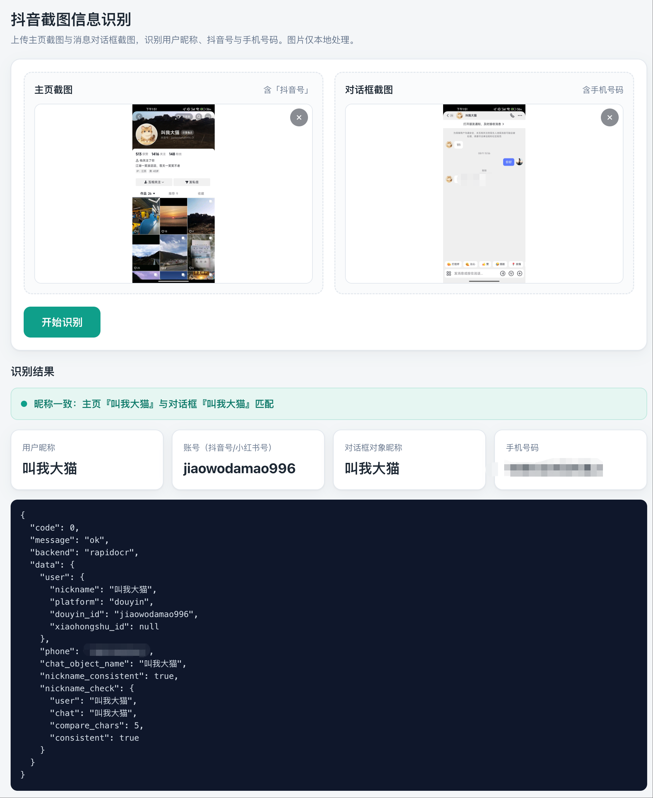
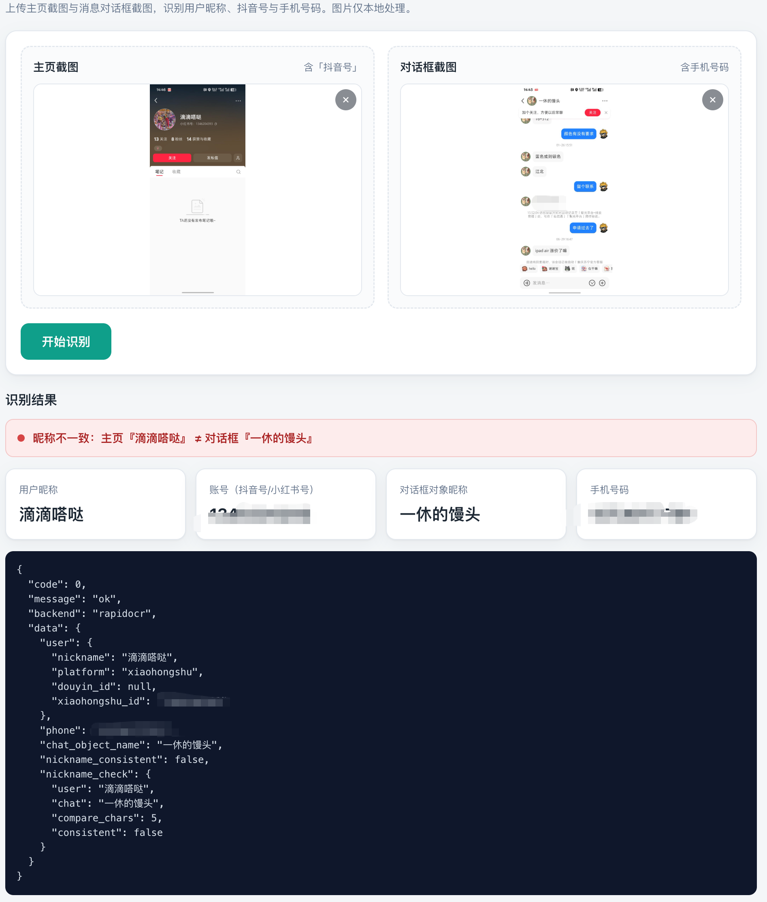

# img-sieve — 抖音 / 小红书 截图信息提取服务

**上传「用户主页」+「消息对话框」两张截图，自动提取昵称、抖音号 / 小红书号、手机号，并核对两处昵称是否一致，输出结构化 JSON。**

本地部署、**纯内网离线运行、图片不出内网**，不依赖任何云端 OCR。

## 核心亮点

* **支持抖音 + 小红书**：一套 RapidOCR（PP-OCR v4）自动区分平台，无需分别部署
* **中文识别准**：RapidOCR 内置 ONNX 模型，昵称 / 账号 / 手机号实测准确
* **零联网**：运行时全程无网络请求，适合纯内网
* **开箱即用**：自包含 Linux 运行时，服务器无需安装 Python

---

## 快速使用（网页界面，最常用）

```
./run.sh --host 0.0.0.0 --port 8080   # 启动服务
```

浏览器打开 `http://<服务地址>:8080/`，上传 **主页截图 + 对话框截图** 两张图，点「开始识别」，

页面即展示昵称、抖音号 / 小红书号、手机号，以及昵称是否一致。


| 抖音                                  | 小红书                               |
| ------------------------------------- | ------------------------------------ |
|  |  |

* 左：识别「叫我大猫 /jiaowodamao996 / 手机号」，昵称一致 ✅
* 右：识别「滴滴嗒哒 / 小红书号 / 手机号」，昵称不一致（滴滴嗒哒 ≠ 一休的馒头）

> 网页为单文件自包含（内联样式与脚本，无外部资源）。接口：
> `GET /`
>
> 网页界面・
>
> `POST /recognize`
>
> 上传 2 图返回 JSON・
>
> `GET /health`
>
> 健康检查

---

## 本地 CLI

```
# 主页图 + 对话框图，自动识别角色与平台
./.venv_test/bin/python cli.py raw/20261015135527202.jpg raw/20261015135547661.jpg

# 指定后端 / 显式指定角色
python3 cli.py <主页图> <对话框图> --backend rapidocr|vision|tesseract|mock
python3 cli.py <主页图> <对话框图> --role <主页图>=user --role <对话框图>=chat
```

---

## 识别结果（样例）

```
{
  "code": 0,
  "message": "ok",
  "backend": "rapidocr",
  "data": {
    "user": {
      "nickname": "叫我大猫",
      "platform": "douyin",
      "douyin_id": "jiaowodamao996",
      "xiaohongshu_id": null
    },
    "phone": "18*********",
    "chat_object_name": "叫我大猫",
    "nickname_consistent": true,
    "nickname_check": {
      "user": "叫我大猫", "chat": "叫我大猫",
      "compare_chars": 5, "consistent": true
    }
  }
}
```

> `data.nickname_consistent`
>
> ：主页昵称与对话框对象昵称是否一致（
>
> `true/false/null`
>
> ），
> 等价于
>
> `data.nickname_check.consistent`
>
> ；按前
>
> **5 位前缀匹配**
>
> ，容忍昵称过长被截断。
> 小红书平台：
>
> `user.platform`
>
> 为
>
> `xiaohongshu`
>
> ，账号存于
>
> `user.xiaohongshu_id`
>
> 。

---

## 服务生命周期

```
./run.sh --host 0.0.0.0 --port 8080   # 启动服务（前台）
./stop.sh [--port 8080]              # 停止服务
./keepalive.sh start [--port 8080]   # 拉起服务 + 保活守护（后台、登出不掉线、崩溃自动重启）
./keepalive.sh status [--port 8080]  # 查看状态
./keepalive.sh stop   [--port 8080]  # 停止守护并关闭服务
```

---

## 异步识别 / 多机部署（MySQL 持久化）

单台机器跑同步识别用不上 MySQL；要做异步识别（先返回 taskId、后台识别再查询结果）和多机共享任务时，才需要 MySQL。

拓扑：MySQL 只装在一台机器（下称机器 A，如 `10.237.179.21`），机器 A 和其它机器（B、C…）都同时跑 HTTP + worker，连同一个库。

### 1. 安装 MySQL 5.7（仅机器 A）

用随包的离线安装包（CentOS 7）：

```bash
tar -xzf mysql-offline-centos7.tar.gz
cd mysql-offline
sudo IMGSIEVE_DB_PASSWORD='业务库强密码' ./install.sh
```

脚本会自动装 RPM、启动 mysqld、建库 `imgsieve` 和用户 `imgsieve`。装完还需让别的机器能连：

```bash
# /etc/my.cnf 的 [mysqld] 段加一行，然后重启
#   bind-address=0.0.0.0
sudo systemctl restart mysqld

# 放行机器 B 的内网 IP
sudo firewall-cmd --permanent --add-rich-rule='rule family=ipv4 source address=机器B的IP port port=3306 protocol=tcp accept'
sudo firewall-cmd --reload
```

> MySQL 5.7 默认密码策略：密码须大写 + 小写 + 数字 + 特殊符号、长度 ≥ 8。

### 2. 创建 .env（每台机器都要，内容一致）

在部署目录 `/opt/server/img-sieve/` 下新建 `.env`：

```bash
cd /opt/server/img-sieve
cat > .env <<'EOF'
# 机器 A（本机有 MySQL）用 127.0.0.1；机器 B/C 填机器 A 的内网 IP
IMG_SIEVE_MYSQL_HOST=127.0.0.1
IMG_SIEVE_MYSQL_PORT=3306
IMG_SIEVE_MYSQL_USER=imgsieve
IMG_SIEVE_MYSQL_PASSWORD=业务库强密码
IMG_SIEVE_MYSQL_DB=imgsieve
EOF
```

- 机器 A 填 `127.0.0.1`；机器 B/C 填机器 A 的内网 IP（如 `10.237.179.21`）。
- 密码就是安装 MySQL 时 `IMGSIEVE_DB_PASSWORD` 设的那个，**所有机器必须一致**。
- 配好后用 `./keepalive.sh start` 启动，它会自动同时拉起 HTTP 和 worker；不配 `IMG_SIEVE_MYSQL_HOST` 则只跑 HTTP、不跑 worker。

```bash
./keepalive.sh start
./keepalive.sh status    # 能看到 服务/守护/worker 三个进程
tail -f logs/worker.log  # 异步识别日志
```

---

## CentOS 7 环境适配说明（依赖版本锁定）

目标部署机多为 CentOS 7 等老系统（GLIBC 2.17），只能使用 `manylinux_2_17` 的 wheel。为在该环境下稳定运行，以下依赖版本被**锁定**（锁定逻辑内置在 `build-linux-runtime.sh` 的自动下载里；`wheels_linux_x86_64/` 不入 git，联网按需下载）：

| 依赖 | 锁定版本 | 说明 |
| --- | --- | --- |
| onnxruntime | **1.16.3** | `manylinux_2_17` 下 pip 可解析到的最高版本；由 NumPy 1.x 编译 |
| numpy | **1.26.4** | 必须 <2，与 onnxruntime 1.16.3 的 C-API 兼容 |
| opencv-python-headless | **4.10.0.84** | 用 headless 替代官方 opencv-python：服务器无显示环境；且 5.x 强制要求 NumPy≥2，与 onnxruntime 冲突 |
| rapidocr_onnxruntime | **1.4.4** | 其依赖声明已由 `opencv-python` 改写为 `opencv-python-headless` |

> **不要自行升级以上版本**，否则会触发兼容问题：
>
> - `onnxruntime` 升到 1.19+：不再提供 `manylinux_2_17` 轮子（改用更高的 manylinux/GLIBC 标签），CentOS 7 无法加载。
> - `numpy` 升到 2.x：onnxruntime 1.16.3 崩溃，报 `AttributeError: _ARRAY_API not found` / `numpy.core.multiarray failed to import`。
> - 用官方 `opencv-python`（非 headless）：服务器缺 Qt/X11 系统库，报 `ImportError: libxcb.so.1: cannot open shared object file`。
>
> 若目标机确为 Ubuntu 等新系统（GLIBC≥2.28），可放宽为 `numpy>=2` + `opencv-python-headless`(5.x) + 新版 onnxruntime。

## 部署/构建注意事项（macOS → CentOS 7）

- **打包**：`pack.sh` 已剥离 macOS 扩展属性（`--no-xattrs --no-fflags`）。若不剥离，包内会携带
  `LIBARCHIVE.xattr.com.apple.provenance` 等 PAX 扩展头，CentOS 老版 GNU tar 解压时误解析，
  导致 `-coloredlogs` 之类的前导 `-` 目录名、甚至文件内容字节错位。
- **构建**：`build-linux-runtime.sh` 在 `wheels_linux_x86_64/` 缺失/为空时会联网自动下载，并完成上述
  版本锁定与 headless 切换；纯内网机器可先在联网机器上执行 `pip download` 填充该目录，再拷进内网离线构建。

---

## 附录

- 核心技术细节（OCR 后端、提取规则、项目结构、Python 版本、部署细节、服务进程管理、测试）：**[doc/technical.md](doc/technical.md)**
- HTTP 接口对接（/recognize 入参、出参、错误码）：**[doc/http-api.md](doc/http-api.md)**
